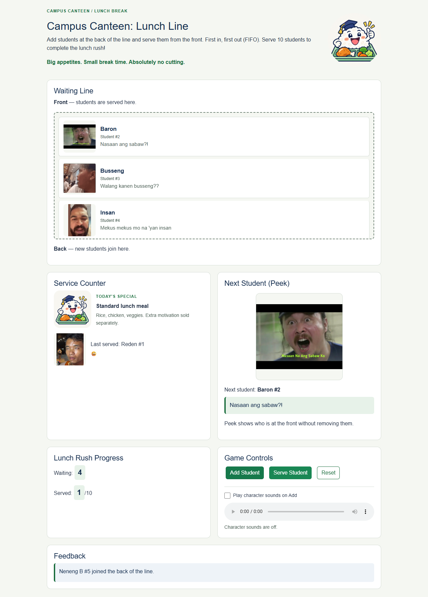
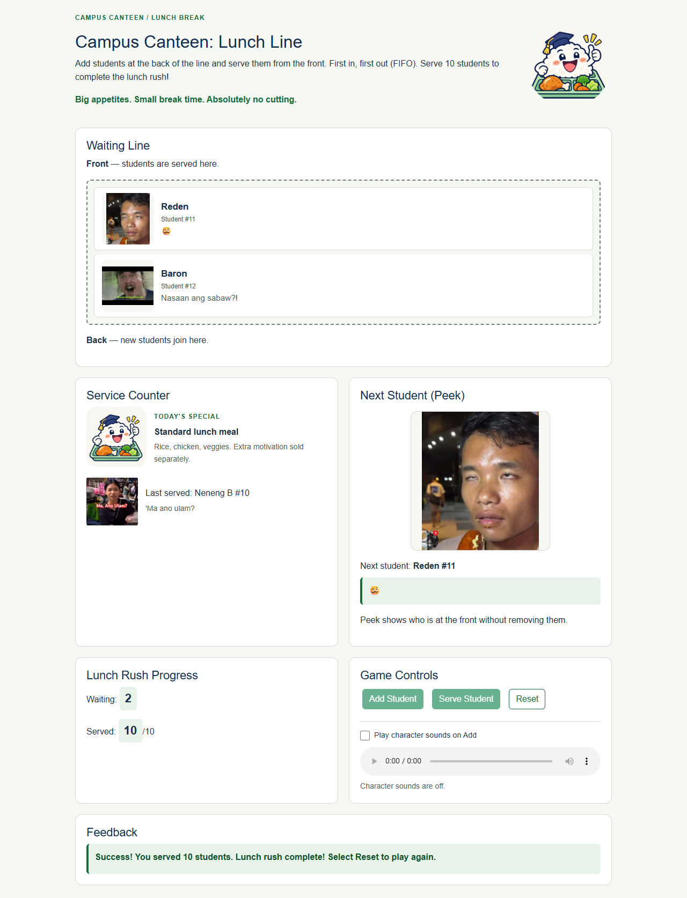

# Campus Canteen: Lunch Line

A simple CC104 Data Structures and Algorithms browser game. Add numbered students to the back of a lunch queue and serve them from the front. Serve 10 students to finish the lunch rush.

## Team

Jared, Eric, Fred, and Russ.

Reported development contributions: Jared built the HTML and Add Student integration; Eric styled the interface and integrated local libraries; Fred implemented initialization and enqueue; Russ implemented dequeue. Final Serve integration, Reset, completion feedback, automated checks, and documentation were completed with AI assistance. Each member must review and understand the final code; this record does not claim they have reviewed those final additions yet.

## Run offline

Download or clone the entire repository. If downloaded as a ZIP, extract it first. Open `index.html` in a modern browser. No server, Node.js, installation, account, or internet connection is needed to play. Keep the `css` and `js` folders beside `index.html`.

Bootstrap CSS and jQuery are included locally with license files in their vendor folders. Refreshing the page starts a new game; progress is not saved.

## How to play

1. Select **Add Student** to append the next numbered student to the back.
2. Read **Next Student (Peek)** to see a large picture, name, queue number, and dialogue for the front student without removing them. The preview clears when the queue is empty or the game is reset.
3. Select **Serve Student** to remove the front student and update **Last served**.
4. Continue until **Served: 10/10**. Add and Serve are then disabled. Any remaining waiting students stay visible until reset.
5. Select **Reset** to clear the queue, counters, last-served display, and feedback, and restart numbering at 1.

Serving an empty queue shows a message and changes no data. There is one standard meal, no priority ordering, and no timer.

## Data structure and algorithms

`queue` is an array of customer objects such as `{ number: 1 }`. Index 0 is the front. FIFO means first in, first out: if #1, #2, #3 arrive, #1 is served first. Customer numbers identify students, not current positions; they never change when someone leaves.

| State | Purpose |
| --- | --- |
| `queue` | Waiting customers in arrival order |
| `nextQueueNumber` | Number assigned to the next arrival |
| `servedCount` | Successful serves, from 0 to 10 |
| `lastServedCustomer` | Customer shown at the counter, initially `null` |
| `SERVED_TARGET` | Completion target: 10 |

| Function | Algorithm and result |
| --- | --- |
| `enqueueCustomer()` | Reject if complete; create a numbered object; append with `push`; advance numbering; return the customer. Returns `null` without mutations after completion. |
| `dequeueCustomer()` | Reject if empty or complete; remove the front with `shift`; increment served; return the removed customer. Rejected attempts return `null` without mutations. |
| `peekCustomer()` | Return `queue[0]`, or `null` when empty. Never removes or changes a customer. |
| `resetGame()` | Restore empty queue, numbering 1, served 0, and no last customer. The Reset event handler clears feedback and redraws. |
| `updateDisplay()` | Traverse the queue to render cards; derive waiting count from its length; call peek; update served/last served and completion button states. |

The jQuery event handlers connect user actions to these functions. The Serve handler uses the returned customer to update Last served only on success. Completion is checked in both the queue operations and the interface, so disabled buttons are not the only protection.

For this array implementation, enqueue is typically amortized O(1), peek is O(1), and dequeue via `shift()` is O(n), because remaining positions move. Rendering is O(n); queue storage is O(n). A queue does not automatically make every operation O(1).

## Technologies and files

- HTML: semantic screen areas and accessible feedback status.
- Bootstrap: local button, list-item, flex, spacing, and responsive utility classes.
- Custom CSS: school colors, cards, responsive grid, and readable feedback.
- JavaScript: queue and game state, operations, and guards.
- jQuery: click handlers, card creation, text updates, and disabled controls.
- GitHub: shared source history and team reviews.

```text
index.html
css/style.css
css/vendor/                  Local Bootstrap and license
js/game.js
js/vendor/                   Local jQuery and license
docs/project-report.html     Printable project document
docs/demo-guide.md           Group demonstration and explanation guide
docs/test-results.md         Actual automated verification record
docs/screenshots/            Actual game screenshots
tests/offline.cjs            Optional developer browser checks
```

## Screenshots





The narrow-screen screenshot is in `docs/screenshots/playing-375.png`.

## Developer checks (optional; not needed to play)

The automated check uses Node.js and Playwright. With Playwright available and its Chromium browser installed, run `node tests/offline.cjs`. Alternatively set `BROWSER_PATH` to an installed Chromium-based browser executable. Tests load the actual `file://` page with browser networking disabled, exercise gameplay at 1280px and 375px, and regenerate screenshots.

See `docs/test-results.md` for checked behavior and remaining human checks. Print `docs/project-report.html` using the browser's print command. Use `docs/demo-guide.md` to prepare the required group video.

## Submission status

The working game and supporting files are prepared. The team still needs to rehearse and explain the final code, record/upload its own group demonstration, confirm the instructor's deadline and identifying details, and submit the printed document and MS Teams materials. Do not describe these activities as finished until they actually occur.


## Cartoon assets and lunch-break humor

Five named user-supplied meme portraits, and a cheerful rice-graduate mascot add personality while keeping the original navy/green school theme. Portraits cycle by student number and follow the student into Last served; they do not affect queue priority or the one-meal rule. Local files, exact built-in image-generation prompts, and usage notes are documented in `assets/README.md`.

`portraitClass(customer)` selects a member profile: one of five local meme photos. `STUDENT_NAMES` and `STUDENT_MOODS` supply five cosmetic character names and captions. `updateDisplay()` renders these alongside the original student numbers and restores the empty scene after Reset. The queue functions and success target are unchanged.


## Character sounds

The five characters are Reden (🥴), Baron, Busseng, Insan, and Neneng B. A successful Add Student click plays that character's user-supplied local MP3. One player replaces the previous clip when another student joins, so clips never overlap. Reset stops sound. Uncheck **Play character sounds on Add** for quiet play; the preference lasts until refresh. The audio controls provide pause, seeking, and volume. No sound starts on page load, peek, or Serve. Audio playback failures do not block gameplay.

The confirmed original filenames and character mappings are in `assets/README.md`. The sound files and Reden portrait are user-supplied and copied unchanged.
