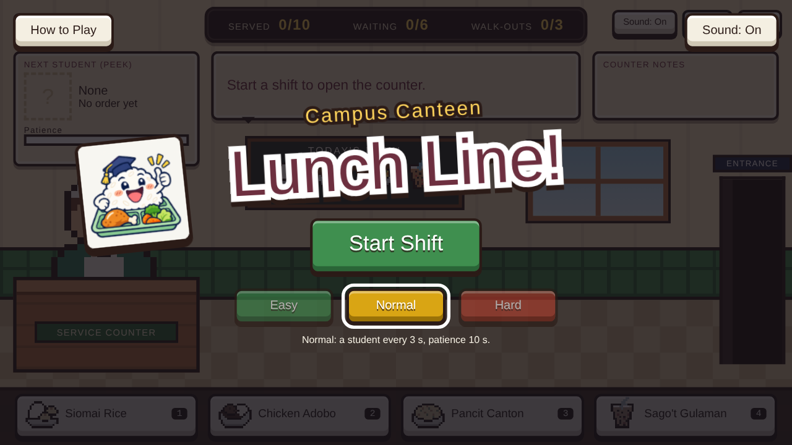
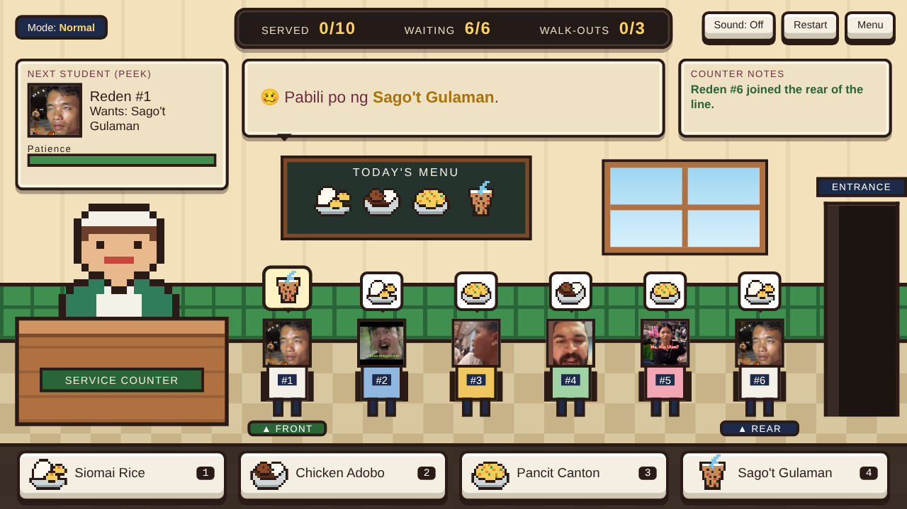
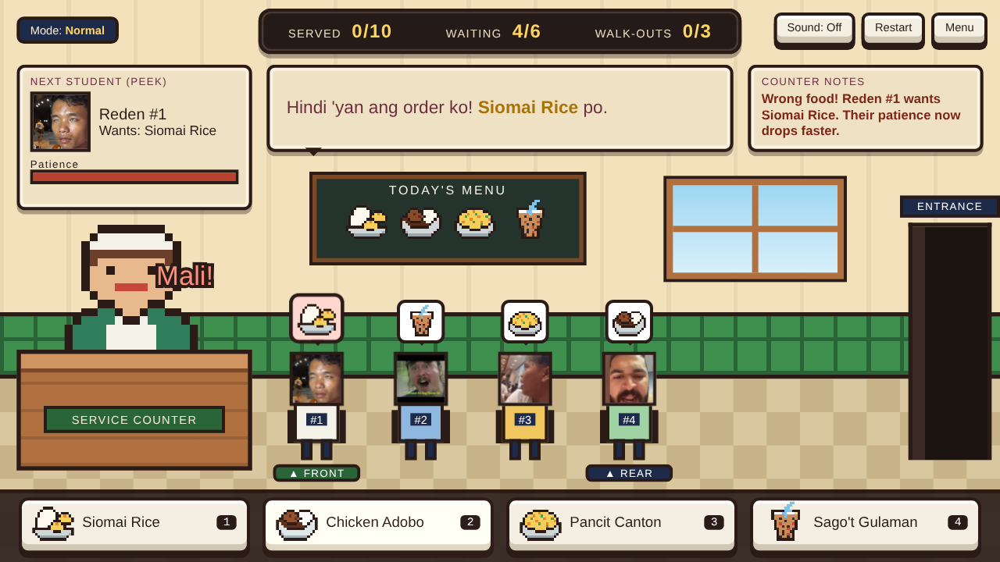
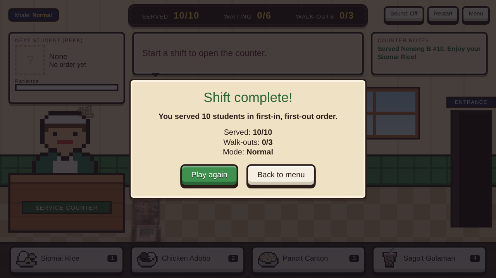
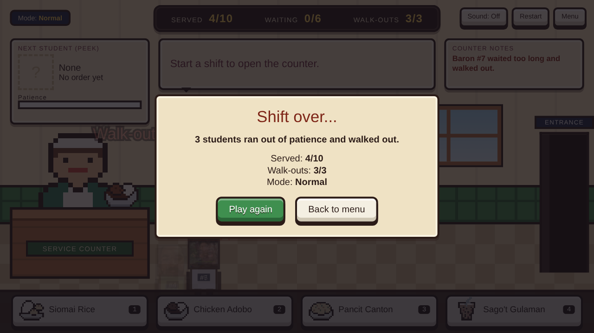

# Campus Canteen: Lunch Line

A CC104 Data Structures and Algorithms browser game (Project 4, Customer Queue Challenge). Students walk into the canteen and line up. You run the counter: serve the student at the FRONT of the line the food they ordered, before their patience runs out. Serve 10 students to complete the shift.

The waiting line is a **queue**. Students join at the REAR (enqueue), only the FRONT student can be served or leave (dequeue), and the NEXT STUDENT panel shows who is at the front without removing them (peek). First in, first out (FIFO).

## Team

Jared, Eric, Fred, and Russ.

The first version of this project (manual Add Student and Serve Student buttons) was built by the team: Jared built the HTML and Add Student integration; Eric styled the interface and integrated the local libraries; Fred implemented initialization and enqueue; Russ implemented dequeue. This version, the "shift" redesign with walking students, food orders, patience, modes, and the new screens, was planned by the team and written with AI assistance. Each member must read and understand the final code before the demonstration; this record does not claim they have done so yet.

## Run offline

Download or clone the entire repository. If downloaded as a ZIP, extract it first. Open `index.html` in a modern browser. No server, Node.js, installation, account, or internet connection is needed. Keep the `css`, `js`, and `assets` folders beside `index.html`.

Bootstrap CSS and jQuery are included locally with license files in their vendor folders. Refreshing the page returns to the main menu; progress is not saved.

The game is one landscape screen that scales to fit the window. On a phone, hold it sideways.

## How to play

1. On the menu, pick **Easy**, **Normal**, or **Hard**, then select **Start Shift**. The first time, a How to Play panel appears; select **Start Shift** on it to begin.
2. Students walk in from the ENTRANCE on the right (the REAR) and line up toward the SERVICE COUNTER on the left (the FRONT). Each student has a number tag and a bubble showing the food they want.
3. Serve **only the FRONT student**: tap the matching food button at the bottom, or press <kbd>1</kbd>-<kbd>4</kbd>.
   - **Right food:** the student leaves happy, Served goes up by 1, and everyone behind walks forward one place.
   - **Wrong food:** you get a warning, the student stays at the counter, and their patience drains faster.
   - You cannot serve anyone further back, even if you know what they want.
4. The front student has a **patience bar**. If it reaches zero, they walk out angry.
5. The shift ends in one of three ways:
   - **Shift complete (win):** 10 students served.
   - **Shift over (lose):** 3 students walked out.
   - **Shift over (lose):** a student arrives while the line already holds 6.
6. **Restart** starts the shift again in the same mode. **Menu** resets everything and returns to the menu. The end screen offers **Play again** and **Back to menu**.

Tapping a food button when nobody is waiting shows "No students waiting. Nobody to serve yet." and changes no data.

### Modes

| Mode | A student arrives every | Front student's patience | After a wrong food, patience drains |
| --- | --- | --- | --- |
| Easy | 4 s | 14 s | 1.5 times faster |
| Normal | 3 s | 10 s | 2 times faster |
| Hard | 2 s | 7 s | 2.5 times faster |

In every mode the first three students arrive 0.8 s apart so a line forms right away, and handing over a meal keeps the counter busy for 1.2 s.

## Screen layout

| Area | What it shows |
| --- | --- |
| Top bar | Mode, Served x/10, Waiting x/6, Walk-outs x/3, and the Sound, Restart, and Menu buttons |
| Next Student (Peek) | Photo, name, queue number, order, and patience bar of the front student, without removing them |
| Order bubble | What the front student is saying |
| Counter Notes | Feedback for the last action. Green = success, red = warning. |
| Scene | Service counter on the left, entrance on the right, students in arrival order between them, with FRONT and REAR tags under the line |
| Food buttons | The four foods. Disabled while a meal is being handed over and when no shift is open. |
| Screens | Main menu, How to Play, and the end-of-shift result |

## Minimum required features (Project 4)

| Requirement | Where it is in the game |
| --- | --- |
| 1. Display a waiting line and service counter | The scene: students between the counter and the entrance |
| 2. Add customers with unique queue numbers | Each arrival is enqueued with the next number (#1, #2, ...) on their shirt |
| 3. Display the queue in arrival order | `renderLine()` places students FRONT to REAR by their index in `queue` |
| 4. Serve only the earliest waiting customer | `serveFood()` only ever compares with and removes `queue[0]` |
| 5. Show the next customer via peek | NEXT STUDENT (PEEK) panel, filled from `peekCustomer()` |
| 6. Track waiting count and total served; block serving an empty queue | Top bar counters; `serveFood()` returns `"empty"` and changes nothing |
| 7. Declare success after serving 10 customers and provide reset | "Shift complete!" at 10; Restart, Menu, Play again, Back to menu |

## Data structure and algorithms

`queue` is an array of customer objects. Index 0 is the FRONT; the last index is the REAR.

```js
{ number: 3, order: "siomai", patience: 10000, annoyed: false }
```

A student's number identifies them and never changes when the line moves.

| State | Purpose |
| --- | --- |
| `queue` | Waiting students in arrival order |
| `nextQueueNumber` | Number given to the next arrival |
| `servedCount` | Students served the right food, 0 to 10 |
| `angryCount` | Students who walked out, 0 to 3 |
| `shiftState` | `"menu"`, `"playing"`, `"won"`, or `"lost"` |
| `lostReason` | `"angry"` or `"line"` when the shift is lost |
| `currentMode` | Which row of `MODES` sets the pace |
| `counterBusy` | True while a meal is being handed over |
| `SERVED_TARGET`, `MAX_ANGRY`, `MAX_LINE` | 10, 3, and 6 |

| Function | Algorithm and result |
| --- | --- |
| `enqueueCustomer()` | Reject if no shift is open or the line is full; create a numbered customer with a random order and full patience; append with `push`; advance numbering; return the customer. Rejection returns `null` with no changes. |
| `dequeueCustomer()` | Return `null` if empty; otherwise remove and return the front with `shift`. |
| `peekCustomer()` | Return `queue[0]`, or `null` when empty. Never changes anything. |
| `customerArrives()` | If the line already holds 6, end the shift as lost; otherwise enqueue. |
| `serveFood(foodId)` | Guards: shift closed, counter busy, empty line. Peek at the front. If the food does not match, mark them annoyed and return `"wrong"`. If it matches, dequeue, add 1 to served, and end the shift as won at 10. |
| `drainFrontPatience()` | Lower only the front student's patience (faster if annoyed). Return true when it reaches zero. |
| `frontCustomerWalksOut()` | Dequeue the front student without a meal; add 1 to walk-outs; end the shift as lost at 3. |
| `resetGame()` | Stop the clock and restore every piece of state to its starting value. |
| `renderLine()` / `updateDisplay()` | Traverse the queue from front to rear and draw each student in that order; update the counters, peek panel, and buttons. |
| `gameTick()` | Runs 10 times a second: add an arrival when one is due, drain the front student's patience, and handle a walk-out. |

Every student leaves through `dequeueCustomer()`, whether happy or angry, so nobody ever leaves from the middle of the line. That is why only the front student is timed.

The queue functions and game rules (parts 3 and 4 of `js/game.js`) never touch the page. The display code (part 6) only reads the data and draws it.

For this array implementation, enqueue is typically amortized O(1), peek is O(1), and dequeue via `shift()` is O(n), because the remaining students move down one index. Drawing the line is O(n); queue storage is O(n), and n is at most 6.

## Technologies and files

- HTML: one stage containing the scene, panels, food buttons, and the three screens.
- Bootstrap (local): base reset, `kbd` styling, and flex, gap, and list utility classes.
- Custom CSS: the pixel-style canteen scene, panels, buttons, students, and animations. Animations are switched off for people who ask their device for reduced motion.
- JavaScript: the queue, game rules, clock, and sound.
- jQuery (local): click and key handlers, building students and buttons, text updates, and showing screens.
- GitHub: shared source history and team reviews.

```text
index.html
css/style.css
css/vendor/                  Local Bootstrap and license
js/game.js                   Queue, rules, audio, display, clock and events
js/sprites.js                Pixel art for the foods and the server (cosmetic)
js/vendor/                   Local jQuery and license
assets/                      Meme portraits, mascot, voice clips
docs/project-report.html     Printable project document
docs/demo-guide.md           Group demonstration and explanation guide
docs/test-results.md         Actual automated verification record
docs/screenshots/            Actual game screenshots
tests/offline.cjs            Optional developer checks (gameplay and queue)
tests/audio.cjs              Optional developer checks (voice clips)
tests/layout.cjs             Optional developer checks (one-screen layout)
```

### Changing the difficulty

The numbers that set the pace are constants at the top of `js/game.js`: `MODES`, `SERVED_TARGET`, `MAX_ANGRY`, `MAX_LINE`, `SERVE_TIME_MS`, `OPENING_RUSH`, and `RUSH_GAP_MS`. To add a food, add one entry to `FOODS` and one picture with the same id to `SPRITE_GRIDS` in `js/sprites.js`.

## Screenshots











Screenshots whose names start with `playing-`, `lunch-`, `meme-`, `five-`, `audio-`, `redesign-`, or `success` show the earlier version of the game and are no longer referenced.

## Art, characters, and sound

The canteen scene, counter, students' bodies, and buttons are drawn with CSS. The four foods and the server are original pixel art stored as letter grids in `js/sprites.js`. The interface style (chunky outlined panels, bevelled buttons, an order bubble, a centred end-of-shift panel) was inspired by the look of the game *Pabili Po!* by Auguste; no files from that game are used.

The five student characters use the team's user-supplied meme photos and voice clips: Reden, Baron, Busseng, Insan, and Neneng B. Characters repeat every five arrivals; queue numbers stay unique. Only the front student's clip plays. It is cut off when they are served or walk out, and the next front student's clip starts. Students joining the rear never restart it. **Sound: Off** silences voices and the beep effects. Details are in `assets/README.md`.

## Developer checks (optional; not needed to play)

The automated checks use Node.js and Playwright. With Playwright available and its Chromium browser installed, run:

```text
node tests/offline.cjs
node tests/audio.cjs
node tests/layout.cjs
```

Alternatively set `BROWSER_PATH` to an installed Chromium-based browser executable. The tests load the actual `file://` page with browser networking disabled. `offline.cjs` and `layout.cjs` also regenerate the screenshots.

See `docs/test-results.md` for what was checked and what still needs a human. Print `docs/project-report.html` using the browser's print command. Use `docs/demo-guide.md` to prepare the group video.

## Submission status

The working game and supporting files are prepared. The team still needs to review and rehearse explaining the final code, play it on each member's computer, record and upload its own group demonstration, confirm the instructor's deadline and identifying details, and submit the printed document and MS Teams materials. Do not describe these activities as finished until they actually occur.
